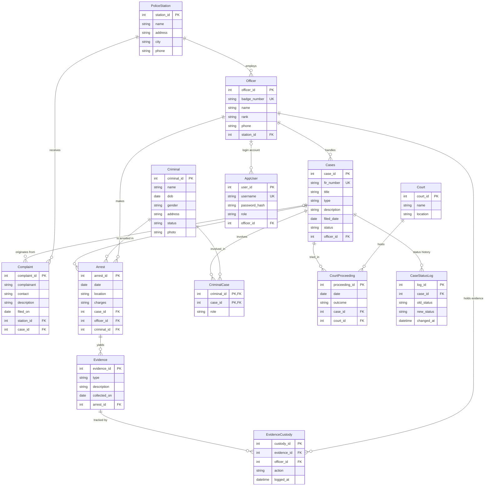

# PCRMS ER Diagram (Crow's Foot notation)

Cardinalities: Station 1:N Officer, Officer 1:N Cases, Criminal M:N Cases (via `CriminalCase`), Case 1:N Arrest, Arrest 1:N Evidence, Court 1:N CourtProceeding, Case 1:N CourtProceeding.
